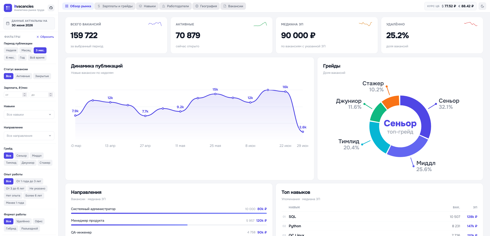
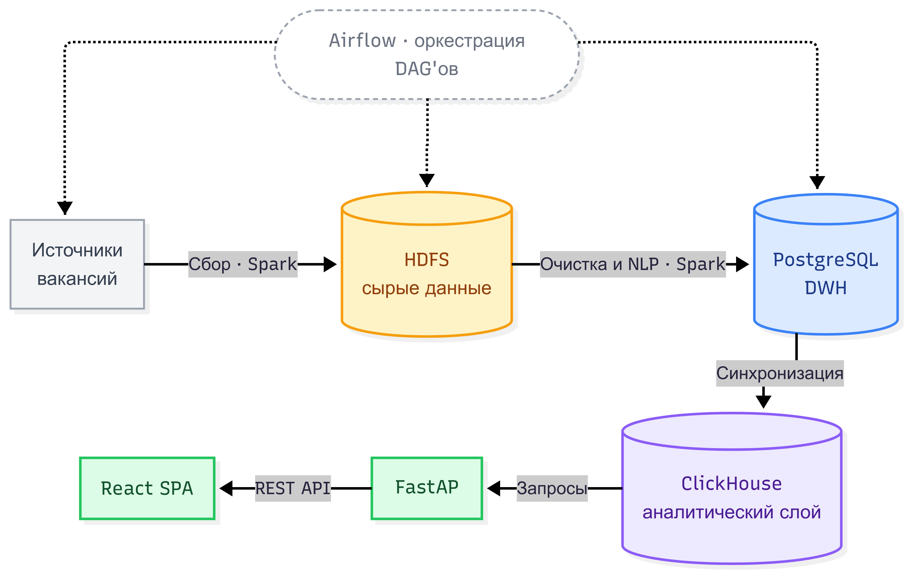
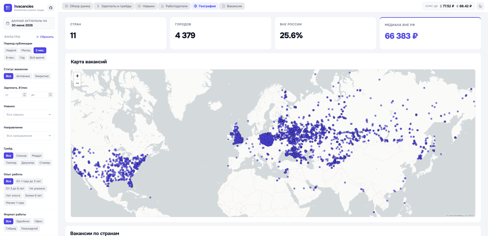
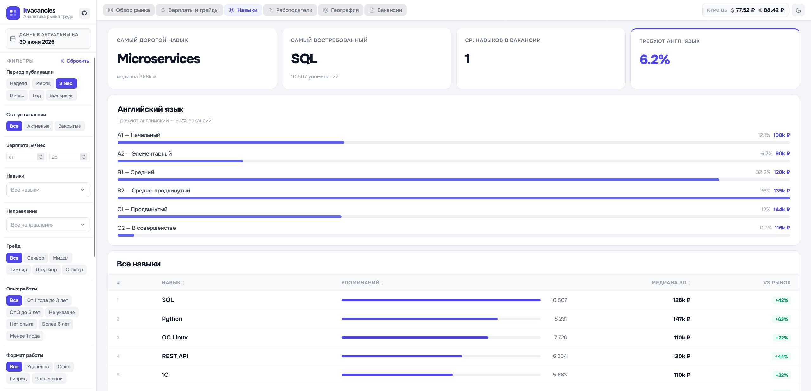
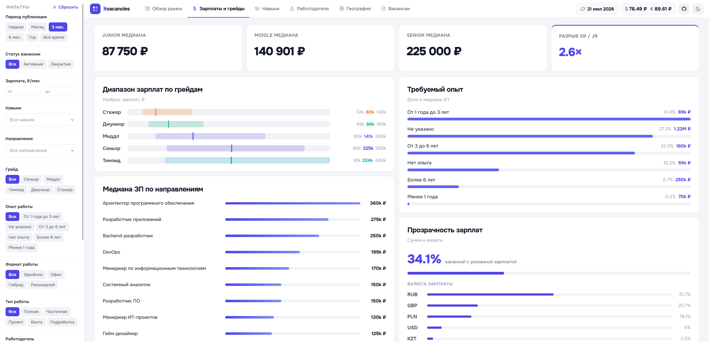

<div align="center">
  

  <h1>itvacancies</h1>
  <p><i>Платформа данных по рынку IT-вакансий: сбор с шести сайтов, нормализация, хранилище и аналитический дашборд</i></p>

  
  
  
  
  
  
  
  
</div>

<br>

> **Статус:** с лета по сентябрь 2026 года проект работал публично на itvacancies.tech, сейчас сервер выключен. Результат видно на скриншотах ниже.

<p align="center">
  
</p>

**Что это.** Платформа по расписанию собирает IT-вакансии с шести сайтов (hh.ru, Хабр Карьера, GetMatch, Finder, GeekJob, Adzuna), сводит их к общим справочникам и показывает аналитику по зарплатам, навыкам, работодателям и городам.

**В цифрах, март–сентябрь 2026:**
- 520 тыс. вакансий, в среднем 2,6 тыс. новых в день
- после склейки дублей осталось 357 тыс. уникальных, дублями оказался 31% записей
- в справочниках 53 тыс. работодателей, 20 тыс. навыков и 11 тыс. локаций в 40 странах
- 12 DAG в Airflow, загрузка в PostgreSQL без дублей при перезапуске, перезаливка ClickHouse без простоя

**Стек:** Spark 4 и Scala 2.13, HDFS, Airflow 2.11, PostgreSQL 17 и Flyway, ClickHouse, Python (FastAPI, Flask, sentence-transformers, rapidfuzz), React и TypeScript, Prometheus и Grafana, Docker Compose, GitHub Actions.

---

## Архитектура

<p align="center">
  
</p>

У каждой площадки свой DAG в Airflow из трёх Spark-задач на Scala:

1. **update** проверяет, какие из открытых вакансий сняты с публикации, и закрывает их в хранилище;
2. **extract** забирает новые вакансии через API или страницы сайта и сохраняет сырые ответы в HDFS;
3. **transform-load** разбирает ответы, приводит должности, грейды, навыки, работодателей, локации и валюты к справочникам и загружает результат в PostgreSQL.

Отдельные DAG склеивают дубли и перезаливают витрину вакансий из PostgreSQL в ClickHouse. Дашборд читает только ClickHouse через FastAPI. Служебные DAG обновляют курсы валют, удаляют устаревшие сырые данные, архивируют HDFS в облако и делают бэкап базы.

Расписания всех DAG задаются cron-выражениями в HOCON-конфигах: у площадок и курсов валют в `conf/platforms/*.conf`, у остальных в `conf/dags/common.conf`. Сбор можно запускать раз в час, раз в неделю или раз в месяц, каждую площадку в своё время. С пустым расписанием DAG запускается только вручную. В тех же конфигах задаются сроки хранения сырых данных и логов, число хранимых бэкапов и минимальное число строк для проверки загрузки.

Новые значения справочников, которые ETL не смог отнести к эталонным, разбираются в отдельной консоли: NLP-сервис на Flask предлагает пары по эмбеддингам (sentence-transformers) и rapidfuzz, а слияние подтверждает человек.

---

## Ключевые инженерные решения

- **Загрузка без дублей.** Spark пишет батч в отдельную staging-таблицу. Одна транзакция переносит его в целевую таблицу через `INSERT … SELECT … ON CONFLICT (бизнес-ключ) DO UPDATE`, после чего суррогатные ключи забираются join'ом staging с целевой таблицей. Перезапуск дня не создаёт дублей.
- **Нормализация в два уровня.** Сначала точное совпадение, потом нечёткое на Spark: блокировка по n-граммам, скоринг и выбор лучшего кандидата через `row_number`. Что не нашло пары, сопоставляется само с собой и становится новыми каноническими значениями. Каждое сопоставление пишется в журнал `match_log_*`.
- **Склейка дублей на SQL.** Вакансии группируются по работодателю, названию и хэшу описания. Если та же вакансия появилась через 60 дней после закрытия предыдущей, это новый наём, а не дубль. Границы считаются оконными функциями (gaps and islands).
- **ClickHouse без простоя.** Витрина перезаливается в staging-таблицу и подменяется через `EXCHANGE TABLES`, поэтому API не видит полупустую таблицу.
- **Аккуратный сбор.** По умолчанию площадки запускаются в разное время, чтобы не нагружать источники и инфраструктуру одновременно. Adzuna опрашивается группами регионов с паузами. После загрузки DAG проверяет минимальное число строк.

## Что бы я сделал иначе

- На таком объёме (тысячи записей в день) хватило бы Python и PostgreSQL или DuckDB, а Spark стоило добавлять при росте. Здесь Spark был учебным выбором и движком для тяжёлого нечёткого join справочников.
- Вместо HDFS взял бы S3-совместимое хранилище (MinIO) и Apache Iceberg.
- Синхронизацию PostgreSQL и ClickHouse перевёл бы с выгрузки через Python на `INSERT … SELECT FROM postgresql(...)` или на инкремент с ReplacingMergeTree.
- Качество данных проверял бы не только по числу строк, но и на уникальность, NULL и свежесть, например через dbt tests или Soda.

---

## Дашборд

React SPA с общими фильтрами по периоду, площадке, направлению, грейду и опыту. Фильтры действуют на все разделы.

- **Обзор:** динамика публикаций, медианные зарплаты, грейды, доля удалённой работы
- **Зарплаты и грейды:** медианы по направлениям, опыту и грейдам
- **Навыки:** самые востребованные технологии, зарплаты по навыкам, требования к английскому
- **Работодатели:** кто больше всех нанимает и сколько платит, динамика найма
- **География:** карта вакансий по городам и странам на WebGL (Leaflet и leaflet.glify), зарплаты и удалёнка по регионам
- **Вакансии:** список актуальных вакансий со ссылками на оригинал

<table>
<tr>
  <td width="33%"></td>
  <td width="33%"></td>
  <td width="33%"></td>
</tr>
<tr>
  <td align="center">География</td>
  <td align="center">Навыки</td>
  <td align="center">Зарплаты и грейды</td>
</tr>
</table>

---

## Запуск локально

Нужны Docker с Docker Compose и не меньше 6 ГБ свободной памяти.

```bash
git clone https://github.com/PiratikMr/itvacancies.git
cd itvacancies
cp .env.example .env   # значения для локального запуска уже заполнены
docker compose up -d
```

База стартует пустой, сбор идёт по расписанию Airflow. Чтобы не ждать, включите DAG нужной площадки в Airflow UI и запустите его вручную.

Ключи площадок и почта для уведомлений лежат отдельно, в HOCON-файлах `conf/secrets/`. Без ключей не запустятся парсеры hh.ru и Adzuna, остальные площадки работают без авторизации. В каждом `.example` есть комментарии.

```bash
cp conf/secrets/local_hh.conf.example           conf/secrets/local_hh.conf            # OAuth-токен hh.ru, https://dev.hh.ru/
cp conf/secrets/local_az.conf.example           conf/secrets/local_az.conf            # https://developer.adzuna.com/
cp conf/secrets/local_exchangerate.conf.example conf/secrets/local_exchangerate.conf  # курсы валют, https://exchangerate.host/
cp conf/secrets/local_airflow.conf.example      conf/secrets/local_airflow.conf       # почта для писем о падениях DAG
cp conf/secrets/local_rclone.conf.example       conf/secrets/local_rclone.conf        # архив HDFS в облако
```

| Сервис | Адрес |
|---|---|
| Дашборд | http://localhost:5173 |
| API (FastAPI) | http://localhost:17000 |
| NLP-консоль | http://localhost:15000 |
| Airflow | http://localhost:11080 (`airflow` / `airflow`) |
| Grafana | http://localhost:16000 (`admin` / `admin`) |
| Spark Master | http://localhost:12080 |
| HDFS NameNode | http://localhost:13870 |
| Prometheus | http://localhost:15090 |
| PostgreSQL | localhost:14432 |
| ClickHouse | localhost:18123 (HTTP), localhost:19000 (TCP) |

---

## Структура проекта

```
.
├── frontend/           # React SPA (Vite, TypeScript)
├── services/
│   ├── api/            # FastAPI, backend дашборда
│   ├── etl/            # Spark ETL на Scala: extract, transform, нормализация, load
│   ├── nlp/            # Flask, консоль нормализации справочников
│   └── orchestration/  # DAG Airflow
├── deploy/             # docker-compose-фрагменты и Dockerfile по сервисам
├── db/                 # схема и миграции PostgreSQL и ClickHouse
└── conf/               # конфиги площадок и DAG, секреты в conf/secrets/ (вне git)
```

---

## Лицензия

[MIT](LICENSE)
